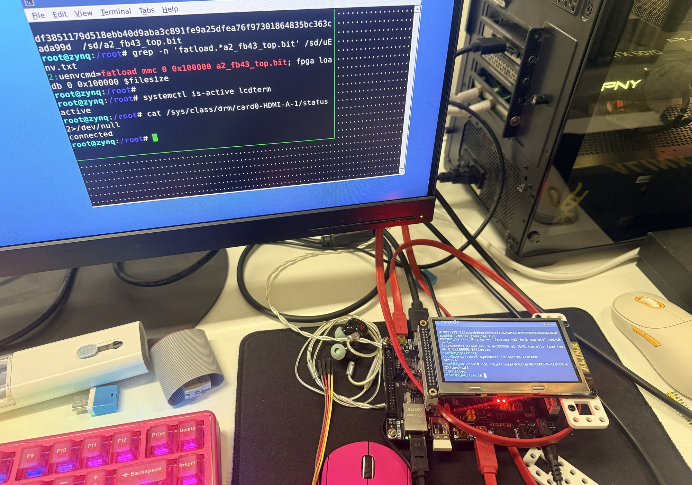
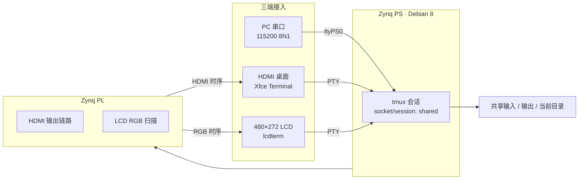

# AX7010 双屏共享终端

> **AX7010 Dual-Screen Shared Console** · HDMI + 480×272 LCD + UART 共享同一个 tmux 会话

<p align="center">
  
</p>
<p align="center"><sub>实机：HDMI 桌面与 480×272 小屏同时显示同一个 tmux 共享会话。</sub></p>


---

## 摘要

本项目在 ALINX AX7010（Xilinx Zynq-7000 XC7Z010-1CLG400）上实现一个**三端共享终端**：HDMI 桌面、480×272 RGB 小屏和 PC 串口同时接入同一个 tmux 会话。三端共享输入、输出与当前工作目录；小屏的 58×15 字符网格决定共享内容的显示尺寸。

项目包含 Vivado 2017.4 构建脚本、启动页叠加层、板端安装/回退脚本，以及 480×272 帧缓冲终端 `lcdterm` 的源码。

## 目录

- [项目概述](#项目概述)
- [系统架构](#系统架构)
- [功能特性](#功能特性)
- [仓库结构](#仓库结构)
- [快速开始](#快速开始)
- [日常使用](#日常使用)
- [启动页](#启动页)
- [验收记录](#验收记录)
- [许可证与第三方 IP](#许可证与第三方-ip)

## 项目概述

| 项目 | 参数 |
| --- | --- |
| 开发板 | ALINX AX7010 |
| SoC / FPGA | Xilinx Zynq-7000 XC7Z010-1CLG400 |
| 开发工具 | Vivado 2017.4 |
| 板端系统 | ALINX Debian 8（Linux） |
| HDMI 输出 | 1920×1080@60，原厂 03 Debian 视频链路 |
| 小屏 | 480×272，8 bpp RGB332 |
| 小屏字符网格 | 58×15 |
| 串口 | 115200 8N1 |
| 共享机制 | tmux，socket/session 均为 `shared` |
| 构建产物 | `dual_console.bit`、`timing.rpt`（不随仓库提交） |

### 设计目标

- **一个会话，三端同步**：HDMI、LCD、串口看到同一份输入输出和当前目录。
- **小屏优先的尺寸约束**：以 58×15 网格作为共享内容的最小显示区域。
- **可安装、可回退**：板端脚本一键安装；保留原厂比特流备份，支持 `rollback.sh` 回退。
- **可复现构建**：Vivado batch 脚本从源码生成比特流与时序报告。

## 系统架构



三端并不是三个独立 Shell：串口登录后由 `/root/.profile` 自动接入，HDMI 由桌面自启动 `shared-console`，小屏由 `lcdterm.service` 启动并 attach 到同一会话。任一端输入的命令、输出和 `cd` 结果都会同步到另外两端。

## 功能特性

- **三端共享**：HDMI 终端、小屏终端和串口共用 tmux `shared` 会话。
- **小屏终端**：`lcdterm` 直接写 480×272 帧缓冲，支持 ANSI 颜色、光标和常用按键。
- **键盘切换**：HDMI 已连接时，`Ctrl+Shift+F12` 在桌面与小屏之间切换键盘焦点。
- **开机启动页**：AX7010 字标扫入、进度百分比、分段走线动画；等待 Linux 时上限 95%，收到小屏首帧后显示 100% 并切换终端。
- **可回退**：安装前备份 `/sd/a2_fb43_top.bit`，`rollback.sh` 恢复上一版双屏比特流。
- **时序收敛**：布线后 WNS +0.510 ns；LCD 数据到 DCLK 的最小 setup 余量 +18.891 ns。

## 仓库结构

```text
AX7010_Shared_Console/
├─ board/                 # 板端安装包
│  ├─ install.sh          # 安装脚本（需 root）
│  ├─ rollback.sh         # 回退脚本
│  ├─ lcdterm.c           # 480×272 帧缓冲终端源码
│  ├─ lcdterm             # 预编译 ARM 二进制
│  ├─ shared-console      # HDMI 桌面启动入口
│  ├─ shared-shell        # tmux 共享 Shell
│  ├─ shared-lcd.ti       # 小屏 terminfo
│  ├─ serial-profile      # 串口自动接入配置
│  └─ ...
├─ vivado/                # Vivado 2017.4 工程
│  ├─ build.tcl           # 一键构建脚本
│  ├─ a2_fb43_top.v       # 顶层
│  ├─ boot_overlay.v      # 启动页叠加层
│  ├─ lcd_fb_scanout.v    # LCD 扫描输出
│  ├─ ip_repo/            # ALINX / Digilent IP
│  └─ ...
├─ docs/images/           # README 配图
├─ README.md
└─ LICENSE
```

## 快速开始

### 1. 构建比特流

```bash
cd vivado
vivado -mode batch -source build.tcl
```

构建完成后得到：

- `vivado/dual_console.bit`
- `vivado/timing.rpt`

### 2. 准备板端安装包

仓库不提交以下二进制产物，需要自行准备：

| 文件 | 来源 |
| --- | --- |
| `board/dual_console.bit` | 上一步 Vivado 构建输出 |
| `board/tmux_1.9-6_armhf.deb` | Debian Jessie 归档 |

tmux 包可从 Debian 归档下载：

<https://archive.debian.org/debian-archive/debian/pool/main/t/tmux/>

```bash
cp vivado/dual_console.bit board/
# 将 tmux_1.9-6_armhf.deb 也放入 board/
```

### 3. 安装到板端

先在目标板上装好上一版 A2 双屏包，然后复制 `board/` 到板上：

```bash
scp -r board root@<board-ip>:/root/
ssh root@<board-ip>
cd /root/board
sh install.sh
reboot
```

安装脚本会：

1. 校验 `SHA256SUMS`；
2. 备份 `/sd/a2_fb43_top.bit` 为 `.before-shared-console`；
3. 安装 tmux（如未安装）与 `lcdterm`；
4. 写入串口自动接入配置；
5. 将新比特流写入 SD 卡 FAT 分区。

### 4. 回退

```bash
cd /root/board
sh rollback.sh
reboot
```

离线回退也可将 FAT 分区的 `a2_fb43_top.bit.before-shared-console` 复制回 `a2_fb43_top.bit`。

## 日常使用

| 操作 | 方式 |
| --- | --- |
| 打开共享终端（HDMI） | Xfce 启动后自动打开；关窗后 `Alt+F2` 输入 `shared-console` |
| 键盘切到小屏 | 按下并松开 `Ctrl+Shift+F12` |
| 键盘切回桌面 | 再按一次 `Ctrl+Shift+F12` |
| 串口登录 | `115200 8N1`，登录后自动进入共享会话 |
| 离开共享会话 | `Ctrl+B`，再按 `D` |
| 结束共享 Shell | 在共享会话中输入 `exit` |

> 串口软件请使用支持 ANSI 的终端。共享内容的尺寸由小屏的 58×15 网格决定。

## 启动页

启动页由 PL 在 Linux 小屏首帧到来之前叠加显示：

1. AX7010 字标从左侧扫入；
2. 中间显示启动进度，四组走线随进度分段亮起；
3. 等待终端时进度上限为 95%；
4. 收到 Linux 小屏首帧信号后显示 100% 约 0.2 秒，再切换到石墨工作台终端；
5. 约 30 秒未就绪时显示 `Terminal not ready`。

## 验收记录

2026-11-04 从 SD 卡重启进行整机验收：

| 检查项 | 结果 |
| --- | --- |
| HDMI 输出 | 1920×1080@60 |
| LCD 服务 | `lcdterm` 运行正常 |
| 串口 | COM19，115200 8N1 |
| 三端会话 | HDMI PTY、LCD PTY、串口均接入 tmux `shared` |
| 输入 / 输出同步 | 通过 |
| 当前目录同步 | 通过 |
| 小屏显示 | 颜色恢复，彩边消失 |
| 布线后 WNS | +0.510 ns |
| LCD 数据 → DCLK setup | +18.891 ns |
| 备注 | 原厂 HDMI SerialClk 约束警告保留 |

## 许可证与第三方 IP

- 本项目代码采用 [MIT License](LICENSE)。
- `vivado/ip_repo/` 下的 ALINX 与 Digilent IP 保留其原始许可，使用前请确认相应授权。
- `board/lcdterm` 为预编译 ARM 二进制，源码见 `board/lcdterm.c`。
